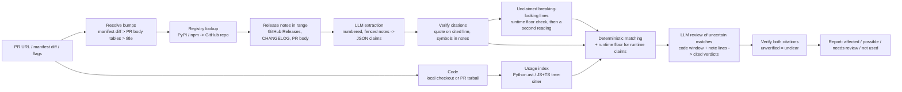

# upgrade-impact

**Does this Dependabot or Renovate bump touch your code, where, and why?**
upgrade-impact reads the release notes between the two versions, turns them into
breaking-change claims with a language model, finds the lines in your repository
that use what changed, and cites both sides: a release-note line and a code line,
each verified by code. If nothing is affected, it says so and tells you why.

> **Status: day 5 of 7.** Works end to end for PyPI and npm bumps on Python and
> JavaScript/TypeScript code, with a model review of borderline matches, a
> calibrated "no impact" and an eval harness with a dataset of 259 real bump
> PRs. New today: grouped PRs checked package by package, a
> [GitHub Action](#in-ci-the-github-action) and an
> [MCP server](#for-coding-agents-the-mcp-server) for Claude Code, Cursor and
> VS Code. Production hardening and the held-out eval are next
> ([plan](docs/PLAN.md), [progress](docs/PROGRESS.md)).

## What it does

`uriyyo/fastapi-pagination#1373` bumped httpx from 0.27.2 to 0.28.0,
and the maintainer pushed a fix to the same PR (`81a3960`, "Remove usage of
deprecated app param"). Pointed at the Dependabot commit, before that fix, with
qwen2.5:7b on Ollama (CPU, no API key):

```text
$ upgrade-impact check https://github.com/uriyyo/fastapi-pagination/pull/1373 \
    --ref e14c865aebed311824f192cefe16e9e64a9ade19 --model qwen2.5:7b
upgrade-impact: httpx 0.27.2 -> 0.28.0 (pypi)
release notes: 0.28.0 from github-release (17 lines)
code: 2 usage(s) of httpx in 1 file(s); 100 Python file(s) scanned
REVIEW: possible impact; read the matched lines
4 breaking change(s): 0 affected, 1 possible, 0 need review, 3 not used by your code

[possible] C4 removed: The `app` argument has been removed.
  notes N11 (0.28.0): "* The deprecated `app` argument has now been removed."
  symbols: app=
  tests/conftest.py:271  async with LifespanManager(app), AsyncClient(app=app, base_url="http://testserver", timeout=60) as c:  (passes app to httpx.AsyncClient; the notes do not say which API lost it)
      model said affected, but the notes do not tie the change to the API this line calls (it named 'app'), so it counts as unclear: The code passes the `app` argument to `httpx.AsyncClient`, which aligns with the removed `app` argument in the notes.

[not_found] C1 deprecated: The `verify` argument as a string is deprecated and will raise warnings.
  notes N6 (0.28.0): "* The `verify` argument as a string argument is now deprecated and will raise warnings."
  symbols: verify=

[not_found] C2 deprecated: The `cert` argument is deprecated and will raise warnings.
  notes N7 (0.28.0): "* The `cert` argument is now deprecated and will raise warnings."
  symbols: cert=

[not_found] C3 removed: The `proxies` argument has been removed.
  notes N10 (0.28.0): "* The deprecated `proxies` argument has now been removed."
  symbols: proxies=

model: ollama qwen2.5:7b, 1 call(s), 884 in / 319 out tokens, 135.9 s
code review: ollama qwen2.5:7b, 1 call(s), 744 in / 137 out tokens, 81.2 s
warning: C4: 1 'affected' verdict(s) named no API from the notes for a parameter-only change and count as unclear

note: analysed uriyyo/fastapi-pagination at e14c865aebed (downloaded source files)
```

`tests/conftest.py:271` is the line the maintainer changed. Every claim quotes the
release-note line it comes from, and the quotes were checked against the notes.
The `proxies`, `verify` and `cert` changes are "not used": no call passes those
arguments. The `app` line stays "possible": the review step read it and said
"affected", but httpx's notes never say which API lost `app` (httpx also has
`ASGITransport(app=...)`, the replacement), so the verdict is not accepted.

That rule is there because of the second demo PR, `cereja-project/govbr_auth#53`
(httpx 0.27 to 0.28.1, merged with manifest changes only). Its 36 "possible" `app`
matches are all `ASGITransport(app=...)` calls, i.e. false alarms. Before the rule,
qwen2.5:7b called six of the twelve it read "affected"; with it, all twelve stay
"possible" and none is promoted. The review needs more context than these notes
give to clear them (the 0.27.0 deprecation notice that names the replacement), which
is still open (see [Limitations](#limitations-day-5)).

Both outputs are from the [`real-model` workflow](.github/workflows/real-model.yml)
([run 45027489304](https://github.com/xeeshan16/upgrade-impact/actions/runs/45027489304),
commit `5501a54`). These are two hand-picked PRs, not an evaluation; see
[Evaluation](#evaluation) for the labelled dataset and baselines.

## Quick start (5 minutes)

```bash
# 1. Install (Python 3.11+). Not on PyPI yet, so install from the repository:
uv tool install git+https://github.com/xeeshan16/upgrade-impact
# or: pipx install git+https://github.com/xeeshan16/upgrade-impact

# 2. A model. Local and free (default):
ollama pull qwen2.5:7b
#    ...or a hosted one: export OPENAI_API_KEY=... / ANTHROPIC_API_KEY=...

# 3. Check a bump PR (its code is downloaded; or run inside your checkout):
export GITHUB_TOKEN=...   # optional for public repos, raises the rate limit
upgrade-impact check https://github.com/you/app/pull/42

# Or check a bump you are about to make, against the current directory:
upgrade-impact check --package httpx --from 0.27.2 --to 0.28.1
git diff main -- requirements.txt | upgrade-impact check -
```

`--format markdown` writes a table for a PR comment or job summary;
`--format json` writes the full report. `--no-llm` skips the model and shows
which release notes were found and where the package is used.

Grouped PRs ("Bump the pip group with 5 updates") are checked package by
package and listed worst first; `--only httpx` picks packages. For scripts:
`--json-out`, `--summary-file`, `--annotate` (GitHub annotations) and
`--fail-on affected|review|unknown`, which exits with code 3 when the verdict
is that or worse.

## In CI: the GitHub Action

Copy [examples/workflows/upgrade-impact.yml](examples/workflows/upgrade-impact.yml)
to `.github/workflows/`. On every Dependabot or Renovate PR it writes the
report to the job summary, puts a warning on each affected line and a notice on
each possible one, and can fail the check:

```yaml
- uses: actions/checkout@v4
- uses: actions/setup-python@v5
  with:
    python-version: "3.12"
- id: impact
  uses: xeeshan16/upgrade-impact@main
  env:
    ANTHROPIC_API_KEY: ${{ secrets.ANTHROPIC_API_KEY }}  # or OPENAI_API_KEY, Azure, base-url
  with:
    fail-on: affected        # never (default), affected, review or unknown
- run: echo "${{ steps.impact.outputs.verdict }}"
```

| Input | Default | |
|---|---|---|
| `pr-url` | the triggering PR | any GitHub PR URL |
| `ref` | checkout / PR head | analyse the code at this commit |
| `only` | all packages | packages of a grouped PR (space or comma separated) |
| `provider`, `model`, `base-url` | from the step's env | as in [Configuration](#configuration) |
| `no-llm` | `false` | never call a model |
| `fail-on` | `never` | `affected`, `review`, `unknown` |
| `annotate` | `true` | line annotations |

Outputs: `verdict` (`affected`, `review`, `unknown`, `no-impact`, or `error`),
`affected-lines`, `packages` and `report-json` (path to the full report).
Workflows that Dependabot triggers do not see repository secrets, so add the
API key as a Dependabot secret too, or point `base-url` at a model server you
run. With no model configured the action says so and runs the no-model check
(breaking-looking note lines and import sites) instead of failing. CI runs the
action on the real fastapi-pagination PR on every push
([`action` job](.github/workflows/ci.yml)).

## For coding agents: the MCP server

`upgrade-impact mcp` serves three tools over stdio:

| Tool | Model? | What it returns |
|---|---|---|
| `assess_bump` | yes | for a PR URL, a manifest diff, or package + versions: each breaking change with its quoted note line, the code lines it reaches, and a verdict per package |
| `find_usages` | no | every import, call (with keyword arguments or options), attribute and method use of a package |
| `get_release_notes` | no | numbered release notes between two versions, breaking-looking and instruction-like lines marked |

Claude Code:

```bash
claude mcp add upgrade-impact -- uvx --from git+https://github.com/xeeshan16/upgrade-impact upgrade-impact mcp
```

Cursor and VS Code: copy [examples/mcp/cursor.mcp.json](examples/mcp/cursor.mcp.json)
to `.cursor/mcp.json` or [examples/mcp/vscode.mcp.json](examples/mcp/vscode.mcp.json)
to `.vscode/mcp.json` ([Claude Code JSON](examples/mcp/claude-code.mcp.json) too).
The server reads code only under its working directory (or the directories in
`UPGRADE_IMPACT_MCP_ROOTS`), runs model calls one at a time, labels release-note
text as untrusted and flags lines that read like instructions to a model. Then
ask: *"Is the axios bump in PR #212 safe to merge? Fix whatever it breaks."*

## How it works



1. **Bump.** Manifest diffs give exact names and versions; the PR body
   (Renovate's table, Dependabot's group table and "Updates `pkg` from A to B"
   lines, skipping the notes Dependabot quotes) and the title fill the gaps
   (lock-file-only PRs). A grouped PR gives one bump per package, each with its
   own slice of the PR body as last-resort notes, and the PR's verdict is the
   worst of them.
2. **Release notes.** The package's repository comes from PyPI `project_urls` or
   npm `repository`. Each version in `(from, to]` takes its GitHub release body,
   or its CHANGELOG section when the release is missing or just says "see
   CHANGELOG". Pre-releases are skipped unless you are upgrading to one.
3. **Claims.** The notes go to the model as numbered lines between fence
   markers derived from their content, with a JSON schema. Each claim must quote the line it comes
   from. Quotes that aren't on the cited line drop the claim; symbols the notes
   never mention are set aside. See [ADR 0001](docs/adr/0001-verified-claims-then-deterministic-matching.md).
4. **Code.** Python files are parsed with `ast`: `import httpx as h` then
   `h.AsyncClient(timeout=5)` is a call to `httpx.AsyncClient` with keyword
   `timeout`, and `c = httpx.Client()` makes `c.get(url)` a call to
   `httpx.Client.get`. JavaScript and TypeScript are parsed with tree-sitter:
   `axios.get(url, { timeout: 5 })` passes `timeout`, `<QueryClientProvider
   client={qc}>` passes `client`, `require` and barrel re-exports are followed.
   Virtualenvs, `node_modules`, `site-packages` and build output are skipped.
5. **Matching.** A claim about a parameter only matches calls that pass it (or
   forward `**kwargs`); removed and renamed symbols match any use; behaviour
   changes on a used symbol are "possible"; claims that name nothing are "needs
   review" when the package is used at all.
6. **Review.** Every match that is not certain goes back to the model with a
   numbered window of the code and the note lines around the claim. It answers
   affected / not affected / unclear per line, citing a code line and a note
   line; both quotes are checked. A verdict that fails the check counts as
   unclear, so an unverified "not affected" never hides a line, and cleared
   lines stay in the report with the reason. See
   [ADR 0002](docs/adr/0002-model-review-of-candidates-with-two-sided-citations.md).
   Replies are cached on disk, so a re-run costs nothing.
7. **Earning "no impact".** A note line that reads like a breaking change and
   that no claim cites holds the bump at "review", because small models skip
   lines. Such a line can leave that list three ways: it is a section heading;
   it is a runtime drop ("Drop support for Node.js 18") that the project's
   declared floor (`engines.node`, `requires-python`, `python_requires`)
   already meets, which is checked by code and cites the manifest line; or a
   second, focused model reading (20 lines per call) quotes the line and says
   it does not change the package's API, and the line names nothing your code
   uses from the package. A "yes" in that reading becomes a claim like any
   other. Runtime claims are checked against the same floor. Every ruled-out
   line is listed with who ruled it out and why, and the report says what
   keeps a bump at "review". See
   [ADR 0004](docs/adr/0004-earning-no-impact.md).
8. **Untrusted notes.** Release notes and PR bodies are written by whoever
   publishes the package. They are fenced with a content-derived marker and
   called data, every claim must quote them, and lines that read like
   instructions to a model (or try to close the fence, or speak the tool's
   JSON) are flagged: a flagged line can't be ruled out and keeps the bump
   from "no impact".

## Evaluation

Does it beat grep? `upgrade-impact eval` answers that on real PRs.

**Dataset** ([data/](data/README.md)): 259 merged Dependabot and Renovate PRs
from 51 public repositories, mined from git history by `upgrade-impact mine`.
61 are *impact* cases: a maintainer pushed code onto the bump PR, and the lines
they changed are the labels. 198 merged with manifest changes only. Only majors
(or 0.x minors) of packages the code imports count, and the dev and held-out
test splits never share a repository
([ADR 0003](docs/adr/0003-labels-from-human-follow-up-commits.md)).

**Systems**, all on the same code snapshot and the same cached release notes:

| System | What it flags |
|---|---|
| `upgrade-impact` | affected lines (strict), plus "possible" ones (lenient) |
| `import-grep` | every line that imports the package |
| `symbol-grep` | identifiers quoted on breaking-looking note lines, grepped in importing files |
| `naive-prompt` | one model call with the notes and the importing files, no verification |

**Metrics**: file precision and recall, hunk recall (a predicted line within
two lines of a fixed hunk), detection (impact cases with at least one right
file), false alarms (clean bumps with anything flagged), lines flagged per
case, model calls and tokens. 95% intervals resample repositories.

```bash
uv run upgrade-impact eval data/cases.jsonl --split dev --model qwen2.5:7b
uv run upgrade-impact eval data/cases.jsonl --split dev --no-llm   # grep baselines only
```

**Measured so far** (dev split, 120 cases from 22 repositories, release notes
from GitHub Releases and CHANGELOGs,
[CI run 45184488973](https://github.com/xeeshan16/upgrade-impact/actions/runs/45184488973)),
the two baselines that need no model:

| System | File precision | File recall | Detected | False alarms | Lines/case |
|---|---|---|---|---|---|
| import-grep | 8.3% (3-47) | 63.5% (35-100) | 91.3% (81-100) | 100% | 10.5 |
| symbol-grep | 37.0% (17-59) | 19.2% (5-35) | 26.1% (12-38) | 23.7% (14-34) | 11.9 |

That is the bar: grepping imports finds most broken files but flags every clean
bump (every case's package is imported somewhere, by construction), and grepping
the notes' identifiers misses about three impact cases in four. (Those two rows
predate day 4, which taught the breaking-line filter that symbol-grep also uses
about changed defaults; CI re-measures them on every push.)

**Real model, dev sample.** qwen2.5:7b on Ollama, on a CPU GitHub runner, on a
fixed sample of 8 dev cases (4 impact, 4 clean, 7 repositories; at most 3
review calls per bump), all four systems on the same notes and code
([run 45405936719](https://github.com/xeeshan16/upgrade-impact/actions/runs/45405936719),
commit `bc6692f`):

| System | Scoring | File precision | File recall | Detected | False alarms | Lines/case |
|---|---|---|---|---|---|---|
| upgrade-impact | strict | 100% | 20.0% | 25.0% | 0% | 0.2 |
| upgrade-impact | lenient | 66.7% | 80.0% | 75.0% | 0% | 7.4 |
| import-grep | strict | 55.6% | 100% | 100% | 100% | 19.2 |
| symbol-grep | strict | 61.5% | 80.0% | 75.0% | 0% | 22.1 |
| naive-prompt | strict | 0% | 0% | 0% | 100% | 1.2 |

upgrade-impact's own answer: 3 of 4 clean bumps "no impact" and 1 "review";
impact cases 1 "affected", 2 "review", 1 "unknown" (no release notes found).
On the same sample the day 3 code answered "review" for all 7 cases with notes
and flagged no line; the day 4 changes (ADR 0004 and the changed-default fixes)
were found by reading this sample's per-case output, so these numbers measure
development progress, not generalisation. Eight cases give intervals too wide to
rank systems (see the run's report); the held-out test split is scored once, on
day 7.

## Configuration

| Setting | Env var | Default |
|---|---|---|
| provider | `UPGRADE_IMPACT_PROVIDER` | `auto`: Anthropic, Azure, OpenAI if their keys are set, else Ollama |
| model | `UPGRADE_IMPACT_MODEL` | `qwen2.5:7b` (Ollama), `gpt-4.1-mini`, `claude-haiku-4-5` |
| base URL | `UPGRADE_IMPACT_BASE_URL` | any OpenAI-compatible server (vLLM, LM Studio) |
| notes chunk size | `UPGRADE_IMPACT_NOTES_BUDGET_TOKENS` | `3000` tokens per extraction call |
| timeout / retries | `UPGRADE_IMPACT_TIMEOUT_S`, `UPGRADE_IMPACT_MAX_RETRIES` | `300`, `3` |
| review cap | `UPGRADE_IMPACT_MAX_CANDIDATES`, `UPGRADE_IMPACT_MAX_REVIEW_CALLS` | `12` code candidates per claim, `8` uncached review calls per bump (`--no-review` turns review off) |
| second reading | `UPGRADE_IMPACT_RECHECK` | `on`: re-read unclaimed breaking-looking note lines (`off` leaves them for you) |
| reply cache | `UPGRADE_IMPACT_LLM_CACHE` | `on` (`off` or `--no-cache` to bypass) |
| cache dir | `UPGRADE_IMPACT_CACHE_DIR` | `~/.cache/upgrade-impact` (downloaded PR code, model replies, eval clones and notes) |
| git host for `mine`/`eval` | `UPGRADE_IMPACT_GIT_URL` | `https://github.com` |

The same keys (lower-case, without the prefix) work in `.upgrade-impact.toml`.
Provider credentials: `OLLAMA_HOST`, `OPENAI_API_KEY`, `ANTHROPIC_API_KEY`,
`AZURE_OPENAI_ENDPOINT` / `AZURE_OPENAI_API_KEY` / `AZURE_OPENAI_DEPLOYMENT`;
GitHub: `GITHUB_TOKEN` or `GH_TOKEN` (sent only to the GitHub API host).

## Design trade-offs

- **The model reads; code checks.** The model turns prose into cited claims and
  reads borderline code lines, but every claim and every verdict must cite
  lines that code then finds. Certain matches never go to the model, and an
  uncheckable verdict changes nothing. That keeps the answer auditable and
  makes small local models usable.
- **Parameter-aware matching** trades recall on dynamic code (`**kwargs`
  forwarding is flagged as "possible", not "affected") for confident "no
  impact" answers on the common case.
- **Release notes over diffs.** Diffing the package's source between versions
  would catch undocumented changes but costs far more and misses behaviour
  changes; notes are what maintainers write for exactly this purpose.

## Limitations (day 5)

- The Action writes the job summary and annotations; it does not post a PR
  comment yet. Grouped PRs are checked one package after another.
- Grouped-PR parsing is tested on Dependabot's and Renovate's body formats,
  not yet run on a real grouped PR (the mined dataset has none).

- Instance types are inferred within one file and without flow analysis: an
  instance created in one module and used in another is not resolved, and a
  name rebound to something else keeps the first class.
- Config files (`pytest.ini`, `setup.cfg`, bundler configs) are not indexed.
- Candidate ranking for claims that name no symbol is lexical; embeddings are
  an extension point, not built yet.
- The second reading's guard is lexical: a ruled-out line that describes a
  change to something your code uses without naming it can get through. The
  runtime check reads only the root manifest (not `.nvmrc`, CI matrices or
  workspace packages).
- Deprecation history is not used yet: "the deprecated `app` argument has now
  been removed" does not say which API, and the earlier notice that does is
  outside the bump's range (the govbr_auth false alarms above).
- Version ranges in titles such as `>=0.27,<0.29` resolve to the lower bound.
- Real-model eval numbers so far come from an 8-case dev sample on a CPU
  runner (see [Evaluation](#evaluation)); the held-out split is scored on day 7.
  The dataset's labels are what maintainers changed, which includes some unrelated cleanup
  and misses fixes that landed in later PRs (ADR 0003).

## Development

See [CONTRIBUTING.md](CONTRIBUTING.md). `uv sync && uv run pytest`.

## License

MIT, see [LICENSE](LICENSE).
