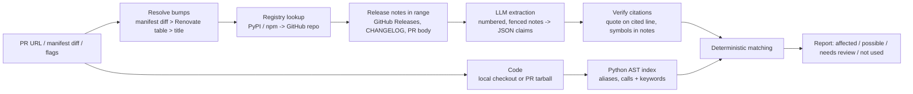

# upgrade-impact

**Does this Dependabot or Renovate bump touch your code, where, and why?**
upgrade-impact reads the release notes between the two versions, turns them into
breaking-change claims with a language model, finds the lines in your repository
that use what changed, and cites both sides: a release-note line and a code line,
each verified by code. If nothing is affected, it says so and tells you why.

> **Status: day 1 of 7.** The end-to-end slice works for PyPI packages and Python
> code. JavaScript/TypeScript indexing, model adjudication of borderline matches,
> the eval on real PRs, the GitHub Action and the MCP server are the next
> milestones ([plan](docs/PLAN.md), [progress](docs/PROGRESS.md)).

## What it does

`uriyyo/fastapi-pagination#1373` bumped httpx from 0.27.2 to 0.28.0,
and the maintainer pushed a fix to the same PR (`81a3960`, "Remove usage of
deprecated app param"). Pointed at the Dependabot commit, before that fix, with
qwen2.5:7b on Ollama (CPU, no API key):

```text
$ upgrade-impact check https://github.com/uriyyo/fastapi-pagination/pull/1373 \
    --ref e14c865aebed311824f192cefe16e9e64a9ade19 --model qwen2.5:7b
upgrade-impact: httpx 0.27.2 -> 0.28.0 (pypi)
release notes: 0.28.0 from github-release (17 lines)
code: 2 usage(s) of httpx in 1 file(s); 100 Python file(s) scanned
REVIEW: possible impact; read the matched lines
4 breaking change(s): 0 affected, 1 possible, 0 need review, 3 not used by your code

[possible] C4 removed: The `app` argument has been removed.
  notes N11 (0.28.0): "* The deprecated `app` argument has now been removed."
  symbols: app=
  tests/conftest.py:271  async with LifespanManager(app), AsyncClient(app=app, base_url="http://testserver", timeout=60) as c:  (passes app to httpx.AsyncClient; the notes do not say which API lost it)

[not_found] C1 deprecated: The `verify` argument as a string is deprecated and will raise warnings.
  notes N6 (0.28.0): "* The `verify` argument as a string argument is now deprecated and will raise warnings."
  symbols: verify=

[not_found] C2 deprecated: The `cert` argument is deprecated and will raise warnings.
  notes N7 (0.28.0): "* The `cert` argument is now deprecated and will raise warnings."
  symbols: cert=

[not_found] C3 removed: The `proxies` argument has been removed.
  notes N10 (0.28.0): "* The deprecated `proxies` argument has now been removed."
  symbols: proxies=

model: ollama qwen2.5:7b, 1 call(s), 880 in / 319 out tokens, 94.6 s

note: analysed uriyyo/fastapi-pagination at e14c865aebed (downloaded source files)
```

`tests/conftest.py:271` is the line the maintainer changed. Every claim quotes the
release-note line it comes from, and the quotes were checked against the notes.
The `proxies`, `verify` and `cert` changes are "not used": no call passes those
arguments. The `app` line is "possible" rather than "affected" because the notes
don't say which API lost `app`, and httpx also has `ASGITransport(app=...)`, which
is the replacement; deciding that from the code is the adjudication step planned
for day 2.

This output is from the [`real-model` workflow](.github/workflows/real-model.yml)
([run 44910332828](https://github.com/xeeshan16/upgrade-impact/actions/runs/44910332828),
commit `ee6fc7a`). On the second demo PR (`cereja-project/govbr_auth#53`, httpx 0.27
to 0.28.1, merged with manifest changes only) the same model reports 36 "possible"
matches for the `app` claim; the eight it prints are all `httpx.ASGITransport(app=...)`
calls. Those are false alarms, and clearing them is the day 2 adjudicator's job. These are two hand-picked PRs, not an evaluation; the
labelled dataset and baselines come on day 3.

## Quick start (5 minutes)

```bash
# 1. Install (Python 3.11+). Not on PyPI yet, so install from the repository:
uv tool install git+https://github.com/xeeshan16/upgrade-impact
# or: pipx install git+https://github.com/xeeshan16/upgrade-impact

# 2. A model. Local and free (default):
ollama pull qwen2.5:7b
#    ...or a hosted one: export OPENAI_API_KEY=... / ANTHROPIC_API_KEY=...

# 3. Check a bump PR (its code is downloaded; or run inside your checkout):
export GITHUB_TOKEN=...   # optional for public repos, raises the rate limit
upgrade-impact check https://github.com/you/app/pull/42

# Or check a bump you are about to make, against the current directory:
upgrade-impact check --package httpx --from 0.27.2 --to 0.28.1
git diff main -- requirements.txt | upgrade-impact check -
```

`--format markdown` writes a table for a PR comment or job summary;
`--format json` writes the full report. `--no-llm` skips the model and shows
which release notes were found and where the package is used.

## How it works



1. **Bump.** Manifest diffs give exact names and versions; Renovate's body table
   and Dependabot/Renovate titles fill the gaps (lock-file-only PRs).
2. **Release notes.** The package's repository comes from PyPI `project_urls` or
   npm `repository`. Each version in `(from, to]` takes its GitHub release body,
   or its CHANGELOG section when the release is missing or just says "see
   CHANGELOG". Pre-releases are skipped unless you are upgrading to one.
3. **Claims.** The notes go to the model as numbered lines between random-nonce
   fence markers, with a JSON schema. Each claim must quote the line it comes
   from. Quotes that aren't on the cited line drop the claim; symbols the notes
   never mention are set aside. See [ADR 0001](docs/adr/0001-verified-claims-then-deterministic-matching.md).
4. **Code.** Python files are parsed with `ast`: `import httpx as h` then
   `h.AsyncClient(timeout=5)` is a call to `httpx.AsyncClient` with keyword
   `timeout`. Virtualenvs, `node_modules`, `site-packages` and build output are skipped.
5. **Matching.** A claim about a parameter only matches calls that pass it (or
   forward `**kwargs`); removed and renamed symbols match any use; behaviour
   changes on a used symbol are "possible"; claims that name nothing are "needs
   review" when the package is used at all.

## Configuration

| Setting | Env var | Default |
|---|---|---|
| provider | `UPGRADE_IMPACT_PROVIDER` | `auto`: Anthropic, Azure, OpenAI if their keys are set, else Ollama |
| model | `UPGRADE_IMPACT_MODEL` | `qwen2.5:7b` (Ollama), `gpt-4.1-mini`, `claude-haiku-4-5` |
| base URL | `UPGRADE_IMPACT_BASE_URL` | any OpenAI-compatible server (vLLM, LM Studio) |
| notes chunk size | `UPGRADE_IMPACT_NOTES_BUDGET_TOKENS` | `3000` tokens per extraction call |
| timeout / retries | `UPGRADE_IMPACT_TIMEOUT_S`, `UPGRADE_IMPACT_MAX_RETRIES` | `300`, `3` |
| cache dir | `UPGRADE_IMPACT_CACHE_DIR` | `~/.cache/upgrade-impact` (downloaded PR code) |

The same keys (lower-case, without the prefix) work in `.upgrade-impact.toml`.
Provider credentials: `OLLAMA_HOST`, `OPENAI_API_KEY`, `ANTHROPIC_API_KEY`,
`AZURE_OPENAI_ENDPOINT` / `AZURE_OPENAI_API_KEY` / `AZURE_OPENAI_DEPLOYMENT`;
GitHub: `GITHUB_TOKEN` or `GH_TOKEN` (sent only to the GitHub API host).

## Design trade-offs

- **The model reads; code checks.** The model never decides which files are
  affected on day 1; it only turns prose into cited claims. That keeps the
  answer auditable and makes small local models usable.
- **Parameter-aware matching** trades recall on dynamic code (`**kwargs`
  forwarding is flagged as "possible", not "affected") for confident "no
  impact" answers on the common case.
- **Release notes over diffs.** Diffing the package's source between versions
  would catch undocumented changes but costs far more and misses behaviour
  changes; notes are what maintainers write for exactly this purpose.

## Limitations (day 1)

- Python code only; npm bumps get release notes and claims but no usage search yet.
- Method calls on instances (`client.get(...)`) are not resolved without types.
- Version ranges in titles such as `>=0.27,<0.29` resolve to the lower bound.
- No evaluation numbers yet: the labelled dataset and baselines arrive on day 3.

## Development

See [CONTRIBUTING.md](CONTRIBUTING.md). `uv sync && uv run pytest`.

## License

MIT, see [LICENSE](LICENSE).
